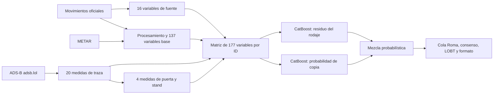
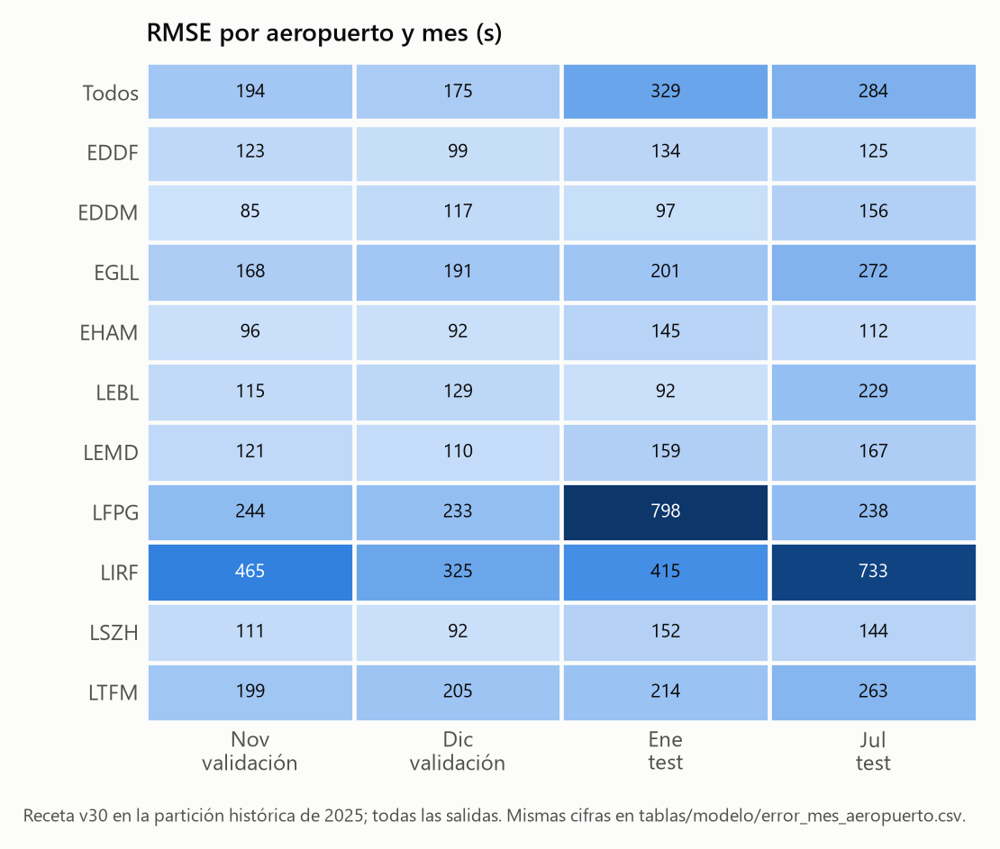
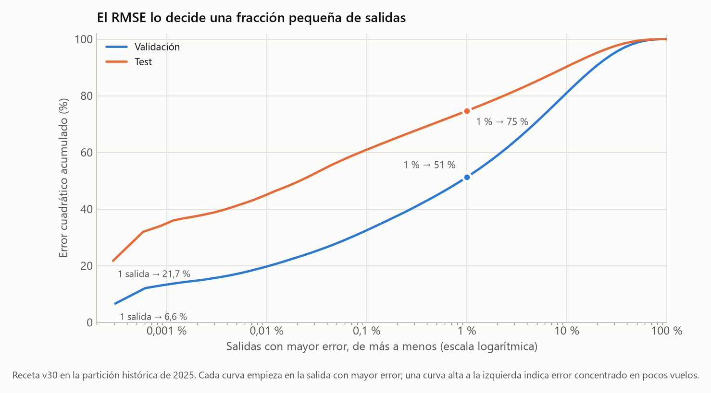
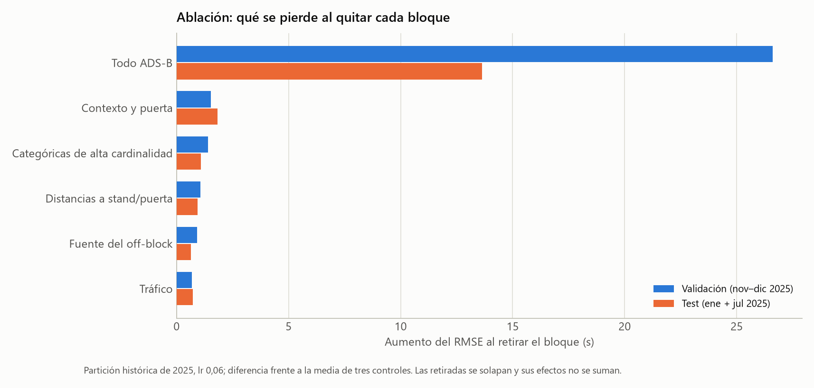
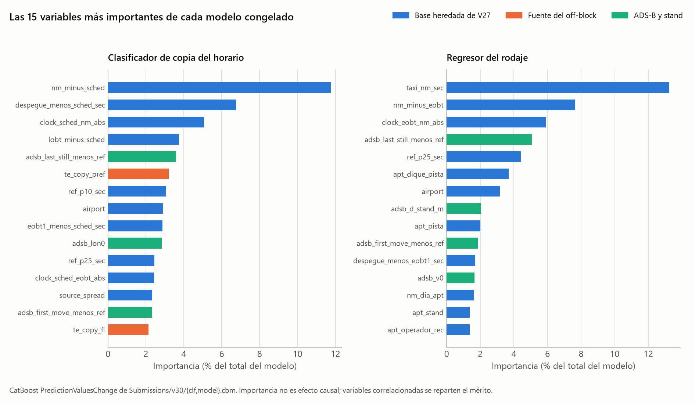
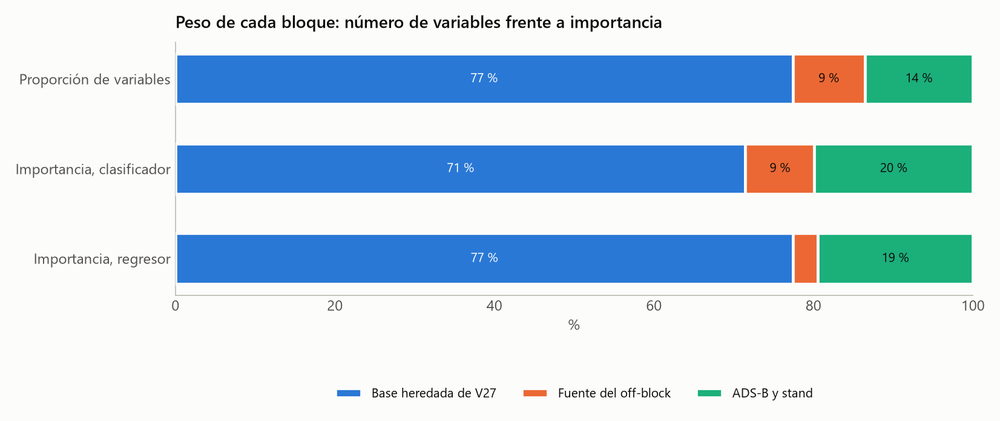
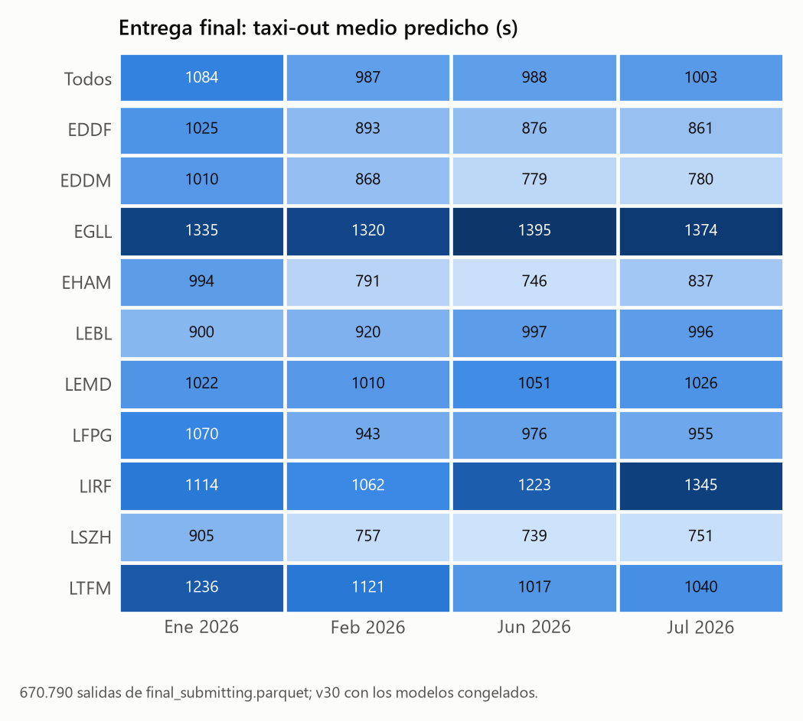
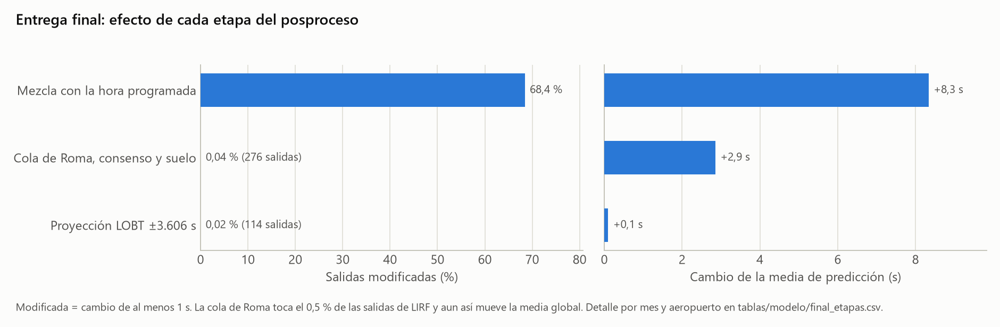
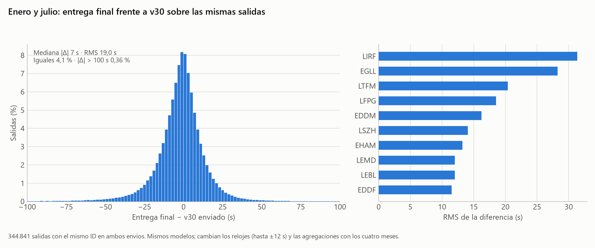

# Modelo final: v30

Modelo elegido para el proyecto. Su RMSE **247,8635 s** corresponde al ranking inicial de enero/julio de 2026.

## 1. Ficha y resultado

| Elemento | Valor |
|---|---|
| Arquitectura | Clasificador de copia del horario + regresor de rodaje, ambos CatBoost |
| Variables | 177: 137 base + 16 de fuente del off-block + 20 ADS-B + 4 de puerta/stand |
| Clasificador | Logloss; profundidad 8; lr 0,06; L2 10; 3.300 árboles |
| Regresor | RMSE sobre `target − ref`; profundidad 10; lr 0,03; L2 10; 24.000 árboles |
| Ajustes comunes | Semilla 42; GPU; `border_count=128`; `max_ctr_complexity=1`; `gpu_ram_part=0.8` |
| Entrenamiento | Todo 2025; filas aptas para el clasificador, aptas sin copia para el regresor |
| Artefactos | `Submissions/v30/{clf.cbm,model.cbm,etapas.parquet,informe.json}` |
| Fichero local | `Submissions/v30/knowledgeable-alligator_v30.parquet` |
| Nombre en el bucket | `knowledgeable-alligator_v29.parquet`, subido el 09/10/2026 |
| SHA-256 | `0fe1cf30303b00135ba5a6f23c56e618f524a6eeea5aa0f7732fc3caf8d1bd6e` |
| Tiempo de entrenamiento | 944,93 s, unos 16 minutos en la máquina original |
| Entrega final | `knowledgeable-alligator_final.parquet`, 14/10/2026 06:59 UTC: los mismos modelos sobre las 670.790 salidas finales ([sección 9](#9-entrega-final)) |

Datos sacados del [informe de entrenamiento](../Submissions/v30/informe.json), del [registro del envío](../Submissions/v30/registro_envio.json) y del [registro de la entrega final](../Submissions/v30_final_modelos/registro_envio.json). No confundir v30 con la candidata de `Submissions/v29/`.

## 2. Por qué dos modelos

El off-block del aeropuerto y el AOBT_3 del Network Manager describen el mismo momento desde sistemas distintos. En parte de las salidas, el off-block registrado es justo la hora programada aunque el avión siguiera en el stand, así que la etiqueta mezcla rodaje físico con una costumbre de registro. En 2025, 112.927 de las 2.083.358 salidas aptas (un 5,4 %) cumplen `|BLOCK − SCHED| ≤ 30 s`, muchas más en Roma; el margen admite redondeos, así que no todas serán copias literales.

Un solo regresor tendría que promediar los dos comportamientos. En v30 estimamos la probabilidad de copia y el regresor aprende el resto:

```text
nm = despegue − AOBT_3
ref = nm, si 0 ≤ nm ≤ 7200; si no, P10 jerárquico
p = P(|BLOCK − SCHED| ≤ 30 s | variables disponibles)
rodaje = max(ref + regresor(x), 0)
senal_horario = max(despegue − programada, 0)
cuerpo = p × senal_horario + (1 − p) × rodaje
```

Con error cuadrático, lo que conviene predecir es la esperanza bajo los dos regímenes, y eso es lo que aproxima la mezcla. `p` se aprende vuelo a vuelo, no se ajusta al leaderboard. El regresor se entrena con 1.970.431 salidas aptas sin coincidencia con el horario.

## 3. Construcción de las entradas



### 3.1. Base heredada de V27: 137 variables

El código está en [prc/base/](../prc/base/). `scripts/variables_base.py` limpia los movimientos y genera once tablas por año: `base`, `extras_v4`, `metar_obs`, `metar`, `combinado`, `meteo_obs`, `meteo`, `trafico`, `puerta`, `alineadas` y `relojes`. La matriz aplica después las referencias congeladas de `configuracion/referencias/`.

| Bloque | Qué aporta |
|---|---|
| Aeropuerto, stand, pista, operador, avión y sus cruces | Geometría y diferencias operativas dentro del aeropuerto |
| NM, horario, EOBT, LOBT e IOBT | Referencias temporales y desacuerdos entre fuentes |
| P10 y P25 | Referencia de rodaje y dispersión por stand/pista, con respaldo jerárquico |
| Tráfico y vecinos | Cola de salida, ritmo de pista, ocupación y rodaje NM cercano |
| Contexto `ctx_*` | Exceso de rodaje frente a la geometría NM estimada con 2025 |
| Retención `gate_*` | Vuelos pendientes de salir de puerta y retraso reciente |
| METAR | Condiciones al despegue, al pushback NM y cambios entre ambos |
| `clock_*` | Resolución de los timestamps y acuerdos o discrepancias entre relojes |

La lista y el orden de las variables base están en [receta.json](../configuracion/receta.json); el [contrato de las 177 variables](tablas/modelo/variables_v30.csv) lo sacamos de los dos modelos guardados, que coinciden.

### 3.2. Fuente del off-block: 16 variables

[scripts/variables_fuente.py](../scripts/variables_fuente.py) junta indicios de que el off-block es una copia del horario y de cómo empareja el vuelo con NM:

| Variables | Qué miden |
|---|---|
| `share_other`, `n_other` | Fracción y número de otras salidas del mismo aeropuerto y vuelo con FLIGHT_ID, en 2025 y 2026 (sin usar el target oculto) |
| `prev_acpy`, `prev_same_pref`, `prev_gap_sched`, `prev_adelay` | Llegada anterior al mismo stand: si coincidió con su horario, prefijo de aerolínea, hueco y retraso |
| `arr_copy_pref_6h`, `arr_n_pref_6h`, `arr_copy_apt_2h` | Tasas de copia en llegadas cercanas, cuyas etiquetas siguen visibles en 2026 |
| `fl_rep`, `fl_nostd`, `fl_len` | Formato del número de vuelo |
| `te_copy_fl`, `te_n_fl`, `te_copy_pref` | Tasas históricas suavizadas de copia por vuelo y prefijo, con etiquetas de 2025 |
| `cross_day_local` | La hora programada y el despegue caen en días locales distintos |

Las `prev_*` se anulan si la llegada anterior es de hace más de 24 h, y un `arr_n_pref_6h` negativo pasa a cero. Al entrenar con todo 2025, las `te_*` de cada fila excluyen su propio mes; en la partición histórica usamos los ficheros `_hist`, ajustados solo con los meses de entrenamiento. 2026 usa etiquetas de 2025, nunca el taxi-out oculto.

### 3.3. ADS-B de la propia aeronave: 20 variables

Las trazas se descargan con `scripts/descarga_adsb_exposed.py` y `scripts/descarga_adsb_github.py` y se guardan por aeropuerto y día. Solo usamos adsb.lol; las pruebas con airplanes.live se quedaron fuera.

[scripts/variables_adsb.py](../scripts/variables_adsb.py) busca el despegue en la traza y la enlaza con el movimiento:

1. Toma los puntos del día con un margen anterior, filtra la fuente y quita duplicados.
2. El despegue es el primer punto en vuelo con altitud positiva y más de 100 kt, con un punto en tierra como mucho 30 min antes (V28 exigía 3 min).
3. Enlaza por el callsign más frecuente cerca del despegue, con una diferencia de 240 s como máximo. Sin callsign, exige el mismo tipo de avión y un único candidato a 90 s o menos.
4. Deja una asignación por traza y mide el tramo en tierra anterior, cortando en huecos de más de 20 min.

Las 17 medidas son `adsb_first_seen`, `adsb_first_move`, `adsb_last_still`, `adsb_move_gap`, `adsb_stat_obs`, `adsb_v0`, `adsb_stop_time`, `adsb_path_m`, `adsb_max_gap`, `adsb_last_ground_gap`, `adsb_d0_m`, `adsb_queue600`, `adsb_n_stops`, `adsb_lat0`, `adsb_lon0`, `adsb_dto` y `adsb_link_cs`; la matriz añade las diferencias de `first_seen`, `first_move` y `last_still` con `ref`. Describen el inicio observado, el movimiento, las paradas, el recorrido, la cola y la calidad del enlace. Ojo: la primera observación no tiene por qué ser el off-block, porque los receptores pueden empezar a ver el avión a mitad del rodaje. Sin enlace, las medidas quedan vacías y el modelo tira de las demás fuentes.

### 3.4. Puerta y stand: 4 variables

[scripts/variables_stand.py](../scripts/variables_stand.py) sitúa cada stand en la mediana del primer punto de los vuelos vistos parados allí (mínimo cinco), con 2025 y 2026 sin etiquetas y umbrales de parada de 15 min para la puerta y 60 s para el stand. `adsb_d_gate_m` y `adsb_d_stand_m` miden la distancia del inicio observado a esas posiciones, y `gate_pos_n` y `stand_pos_n`, cuántos vuelos las respaldan. Una distancia grande indica que nos falta el comienzo del movimiento. Como usan los vuelos de ambos años, hay que recalcularlas si cambia el conjunto que se predice.

### 3.5. La matriz

[scripts/matriz.py](../scripts/matriz.py) une los bloques por `MVT_ID_mvt` (uno a uno), conserva todas las filas base, pasa las 14 categóricas a texto para CatBoost y exige las mismas columnas, en el mismo orden, en 2025 y 2026. La de entrenamiento tiene 2.085.047 filas y 177 variables; la del ranking inicial, 344.841 filas.

## 4. Selección y entrenamiento final

Para elegir la receta partimos 2025 en entrenamiento (febrero–junio y agosto–octubre), validación (noviembre–diciembre) y test (enero y julio), y comparamos los candidatos sobre las mismas filas y contra las predicciones de V27. La validación hace de parada temprana; `week0` y `week2` prueban otro reparto temporal. El experimento elegido, `mezcla_fuentes+adsb+adsb_stand_lr03`, dio ([métricas](tablas/modelo/metricas_seleccion_v30.json), copia de `Data/experimentos/`):

| Medida | Valor |
|---|---:|
| Árboles del clasificador | 3.218 |
| Árboles del regresor | 21.521 |
| RMSE validación completa | 184,3672 s |
| RMSE test completo | 304,6691 s |
| RMSE test NM apto | 195,6090 s |
| AUC de copia en test | 0,9005 |

Los 184,77 y 302,00 que aparecen en informes anteriores son de `blend_lgb.json`, otra evaluación de mezcla que usamos como control; la selección es la de `metricas.json`.

Entrenando con todo 2025 ya no hay meses para parar a tiempo, así que fijamos 3.300 y 24.000 árboles: lo que salió en la selección, redondeado y con algo de margen para doce meses de datos. El código es [scripts/entrenar.py](../scripts/entrenar.py) y los parámetros están en el informe de v30.

Estas cifras sirven para comparar candidatos entre sí, no como estimación independiente: reutilizamos las particiones durante toda la investigación y las referencias P10 heredadas se ajustaron con todo 2025, así que la validación y el test locales llevan algo de información de las etiquetas.

### 4.1. Dónde se equivoca la receta

El modelo enviado se entrenó con todo 2025 y no tiene meses reservados para medir su error. Las tres figuras usan las predicciones del experimento seleccionado (misma receta, sin los meses de validación y test), que reproducen exactamente la tabla anterior.


Roma y París concentran el error del test: 617 s y 565 s de RMSE con todas las salidas, frente a 128–184 s en Frankfurt, Múnich, Ámsterdam, Barcelona y Zúrich. Con NM válido y etiqueta apta, París baja a 232 s y Roma a 346 s: en París el exceso viene casi todo de unas pocas etiquetas extremas, mientras que en Roma el error sigue alto en el régimen normal. El sesgo por aeropuerto es pequeño (entre −8 y +15 s); fallamos por dispersión y por la cola, no por nivel.



Por meses se ven episodios concretos: París pasa de unos 240 s en noviembre, diciembre y julio a 798 s en enero, y Roma llega a 733 s en julio. Heathrow y Barcelona empeoran en julio; Ámsterdam y Zúrich, en enero.



En el test, una sola salida aporta el 21,7 % del error cuadrático; 34 salidas (el 0,01 %), el 45 %, y el 1 % de las salidas, el 75 %. En validación el 1 % suma el 51 %. Por eso los cambios en la cola mueven el RMSE más que las mejoras generales, y por eso la validación de noviembre–diciembre predice mal el test: depende de qué extremos caen en cada periodo. Tablas: [por aeropuerto](tablas/modelo/error_aeropuerto.csv), [por mes](tablas/modelo/error_mes_aeropuerto.csv) y [concentración](tablas/modelo/error_concentracion.csv).

## 5. Posproceso

| Etapa | Qué hace |
|---|---|
| Cola de Roma | En LIRF, sin FLIGHT_ID y con despegue más de 2 h después de la hora programada, mezcla el cuerpo con `despegue − programada` |
| Ajuste de la cola | Pendiente por tramo de retraso (2–3 h, 3–6 h, >6 h) y grupo de emparejamiento NM; prior 20 y límite [0;1,5] |
| Consenso | Si NM, horario, EOBT y LOBT apuntan todos a más de 2 h, mezcla con el mínimo de los cuatro |
| Suelo | Ninguna predicción por debajo de 60 s |
| Proyección LOBT | Recorta a `(despegue − LOBT) ±3606 s` cuando hay LOBT |
| Formato | Un único redondeo a `int32`, IDs `float64`, orden de la plantilla y sin nulos |

La cola ajusta la pendiente de `(target − referencia)` frente a `(despegue − programada − referencia)`. Un vuelo es del grupo habitual si `n_other ≥1` y `share_other ≥0,9`. Las pendientes de v30 (habitual/raro) fueron 0,539/0,889 entre 2 y 3 h, 0,621/0,879 entre 3 y 6 h y 1,093/1,060 por encima de 6 h; las mayores que 1 extrapolan y no son probabilidades. El coeficiente del consenso fue 0,875. El código está en [cola_roma.py](../scripts/cola_roma.py) y [post_proceso.py](../prc/base/post_proceso.py). El margen LOBT sale de la regla de emparejamiento, comprobada con estos datos; no es un límite físico.

## 6. Qué aporta cada bloque: ablación

La ablación tiene 34 configuraciones ([tablas/modelo/ablacion.csv](tablas/modelo/ablacion.csv), copia de `Data/ablacion/resumen.csv`). Para abaratar reentrena con lr 0,06, así que no evalúa el modelo congelado de 24.000 árboles. El control se repite con las semillas 42, 7 y 123.



| Bloque retirado | Δ RMSE validación | Δ RMSE test | Δ test normal |
|---|---:|---:|---:|
| Todo ADS-B, incluidas distancias y diferencias | +26,60 | +13,63 | +20,73 |
| Todo lo nuevo respecto a la base de V27 | +27,38 | +14,39 | +21,30 |
| Contexto de congestión y puerta | +1,53 | +1,83 | +2,76 |
| Categóricas de alta cardinalidad | +1,40 | +1,08 | +1,24 |
| Distancias a puerta/stand | +1,06 | +0,93 | +1,30 |
| Fuente del off-block | +0,91 | +0,64 | +0,88 |
| Tráfico | +0,68 | +0,72 | +1,27 |

Segundos frente a la media de los controles; positivo es peor. Las retiradas se solapan y sus efectos no se suman.

Algunos grupos sobran por separado (calendario, dígitos y coherencia de relojes, METAR y `source_*`), pero quitarlos juntos, con listas de 155, 124 o 108 variables, cuesta unos 0,6–0,8 s en el test normal, y quedarse con las 130 o 100 más importantes también empeora. La dispersión entre controles ronda 0,12 s. Nos quedamos con las 177, aunque podría existir una selección mejor.

### 6.1. Importancia de variables en los modelos congelados

La ablación mide cuánto se pierde al quitar un bloque y reentrenar; la importancia, cuánto usa cada variable el modelo ya entrenado. Usamos el `PredictionValuesChange` de CatBoost sobre `Submissions/v30/{clf,model}.cbm`, el mismo del [contrato de variables](tablas/modelo/variables_v30.csv).



El clasificador mira sobre todo el desacuerdo entre relojes: `nm_minus_sched` (11,8 %), `despegue_menos_sched_sec` (6,8 %) y `clock_sched_nm_abs` (5,1 %), es decir, lo lejos que quedan NM y el despegue de la hora programada. El regresor parte de la referencia NM (`taxi_nm_sec`, 13,3 %) y la corrige con los desacuerdos EOBT/NM y la dispersión del stand (`ref_p25_sec`). En los dos, la primera variable ADS-B, `adsb_last_still_menos_ref` (el último momento en que la traza estaba quieta, respecto a la referencia), está entre las cinco primeras.



ADS-B y stand son el 13,6 % de las variables y se llevan el 19,9 % y el 19,5 % de la importancia; la base heredada pesa lo que ocupa. Las 16 variables de fuente pesan lo suyo en el clasificador (8,7 %) y poco en el regresor (3,1 %), como cabe esperar de su papel: detectar copias. La importancia se reparte entre variables correlacionadas y no mide efectos causales; para eso está la ablación. Tabla: [importancia por bloque](tablas/modelo/importancia_bloques.csv).

## 7. El error de signo en ADS-B

El extractor de v30 suma el desfase entre el despegue ADS-B y el de MVT en tres tiempos cuando debería restarlo. En la ablación probamos la corrección `valor − 2 × dto` en `first_seen`, `first_move`, `last_still` y sus diferencias con la referencia:

| Semilla | Δ validación completa | Δ test completo |
|---|---:|---:|
| 42 | −0,2100 | −0,0760 |
| 7 | −0,2295 | −0,4970 |
| 123 | −0,0444 | −0,2673 |
| Media | −0,1613 | −0,2801 |

La mejora es pequeña y v30 mantiene el signo original: corregir sus entradas con los modelos congelados haría que recibieran al predecir algo distinto de lo que vieron al entrenar. Una receta nueva tendría que corregir entrenamiento e inferencia a la vez y volver a evaluarse.

## 8. Reproducción

La [guía general](00_General.md#5-cómo-ejecutarlo) explica cómo ejecutar los cuadernos en cada periodo. Hay que conservar modelos, tablas base, referencias y variables propias, porque al regenerarlas pueden cambiar los METAR, los desempates de las agregaciones y las posiciones de los stands. Con los modelos guardados reproducimos el fichero enviado con el mismo SHA-256 ([informe](../Submissions/v30_recreado_modelos/informe.json)); reentrenando ([informe](../Submissions/v30_recreado/informe.json)) las predicciones difieren en un RMS de 24,6 s, porque CatBoost en GPU no es determinista.

El conjunto final tiene 670.790 filas y una cobertura ADS-B del 61,3–69,8 % según el mes; sus cambios y riesgos (sobre todo Frankfurt en febrero y Roma en verano) están en el [documento de datos](03_Datos_y_analisis.md).

## 9. Entrega final

Los cuatro meses finales no traen etiqueta, así que no había nada nuevo con lo que entrenar. Aplicamos los modelos congelados de v30 a las variables recalculadas de enero, febrero, junio y julio de 2026, con los cuadernos en `PERIODO = "final"`, y lo subimos con `Notebooks/07_envio.ipynb`.

| Elemento | Valor |
|---|---|
| Fichero local | `Submissions/v30_final_modelos/knowledgeable-alligator_v30_final_modelos.parquet` |
| Nombre en el bucket | `knowledgeable-alligator_final.parquet`, subido el 14/10/2026 a las 06:59:49 UTC |
| SHA-256 | `03faee3d822ee45b38f264f8186b47f8abc514c15c2025dceac77e29b1cdd6db` (el mismo en el bucket) |
| Respuesta del bucket | `Succeeded`, 670.790 pares casados con `final_submitting.parquet`; sin puntuación publicada |



La media predicha es 1.014 s: 1.084 s en enero y entre 987 y 1.003 s el resto. Enero es el mes más alto en Frankfurt, Múnich, Ámsterdam, París, Zúrich y Estambul; Barcelona, Madrid, Heathrow y Roma predicen más en verano. Heathrow es el más lento (1.320–1.395 s) y Roma llega a 1.345 s en julio, cuando además pierde cobertura ADS-B.



La mezcla con la hora programada mueve al menos 1 s el 68 % de las predicciones y sube la media 8,3 s (85 s en Roma, donde la probabilidad de copia es mayor). La cola de Roma, el consenso y el suelo solo tocan 276 salidas, casi todas de Roma, pero les cambian de media unas 1,9 h, lo que sube la media global 2,9 s. La proyección LOBT afecta a 114 salidas.



Enero y julio están en los dos conjuntos con los mismos ID. Con los mismos modelos, las predicciones cambian poco: mediana de |Δ| de 7 s, RMS de 19 s y un 0,36 % por encima de 100 s. Las diferencias vienen de los relojes, que en los ficheros finales se mueven hasta ±12 s, y de las agregaciones recalculadas con cuatro meses (fuente del off-block y posiciones de stands). Heathrow y Roma son los que más cambian (RMS de 28 y 31 s). Tablas: [medias](tablas/modelo/final_media_mes_aeropuerto.csv), [etapas](tablas/modelo/final_etapas.csv) y [comparación con v30](tablas/modelo/final_vs_v30.csv).

Las tablas y figuras de esta sección y de las 4.1 y 6.1 salen de [scripts/figuras.py](../scripts/figuras.py).
