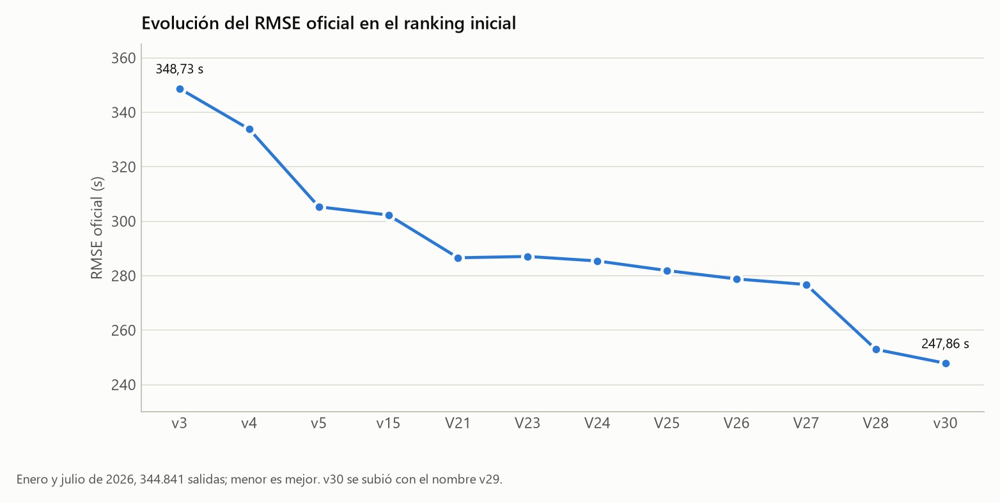
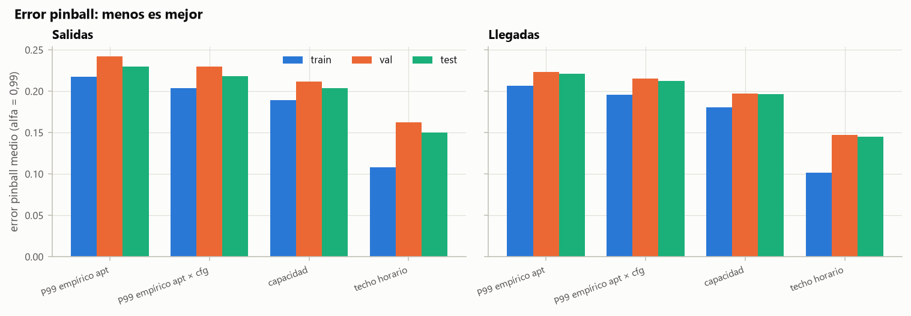

# Modelos anteriores y experimentos

Qué probamos, para qué, qué salió y por qué lo mantuvimos o lo descartamos. Reúne nuestras bitácoras, las métricas que se conservan y lo que quedó en `trash/experimentos/`. La receta actual está en [01_Modelo_final_v30.md](01_Modelo_final_v30.md).

## 1. Cómo leer las cifras

El RMSE oficial es el del reto (enero y julio de 2026); el local, el que calculamos con 2025. Solo comparamos cifras de la misma población de filas, y mejorar un segmento no garantiza mejorar el total.

La partición histórica entrena con febrero–junio y agosto–octubre, valida con noviembre–diciembre y prueba con enero y julio; `week0` y `week2` reservan semanas sueltas. Las reutilizamos muchas veces y se solapan, así que seis comparaciones favorables no son seis pruebas independientes, y los remuestreos por día no corrigen ni la selección previa ni la incertidumbre sobre 2026.

De las primeras versiones solo quedan las cifras de los documentos originales. Las de V28 y v30 están respaldadas por sus registros en `Submissions`.

## 2. Evolución de las versiones



| Versión | RMSE oficial (s) | Cambio | Para qué |
|---|---:|---|---|
| v1–v2 | Sin registro oficial completo | Primeras referencias y reglas | Entender referencias, sesgos y cola |
| v3 | 348,73 | LightGBM global, 23 entradas y regla de Roma | Primer punto de comparación |
| v4 | 333,84 | LightGBM por aeropuerto, varias semillas, referencia P10 | Geometría local, tráfico y stand |
| v5 | 305,30 | v4 con mezcla de cola | Los pocos extremos que dominan el RMSE |
| v15 | 302,2829 | Ensemble LightGBM con cola y METAR; 52 modelos | Añadir meteorología |
| v16–v19 | 320,57 / 307,14 / 316,35 / 308,01 | Variables nuevas, clasificador de recuperables, ajustes de cola | Mejorar v15; no se trasladó al ranking |
| v20 | Sin score oficial identificado | Recalibración de la regla, auditada | Revisar el peso de la señal programada |
| V21 | 286,5911 | Un CatBoost global residual, 90 variables, calibración y consenso | Simplificar y modelar la diferencia entre fuentes |
| V23 (`cut60`) | 287,0734 | V21 con 60 variables | Simplificar; no superó a V21 |
| V24 | 285,4183 | V21 con proyección LOBT | Usar el intervalo de emparejamiento NM |
| V25 | 281,8996 | Contexto de tráfico, METAR corregido, profundidad 10; 89 variables | Separar geometría y congestión |
| V26 | 278,8182 | V25 con tres variables de puerta; 92 variables | Distinguir retención en puerta y rodaje |
| V27 | 276,7668 | Dos CatBoost y diez LightGBM lineales; hasta 137 variables | Combinar errores distintos |
| V28 | 252,9635 | Copia/no copia, fuente del off-block y ADS-B; 173 variables | Movimiento observado y mecanismos de la etiqueta |
| v30 | 247,8635 | V28 con enlace ADS-B relajado, stand/puerta y lr 0,03; 177 variables | Más cobertura y fiabilidad del inicio observado |

v30 se subió como `_v29`. Algunos números de versión fueron recombinaciones o ensayos sin receta propia, y las figuras antiguas `v0` a `v3` son del análisis inicial, no versiones del ranking.

## 3. Primera etapa: referencias, tráfico y LightGBM

Partimos de taxi-out = recorrido de referencia + espera. El P10 por aeropuerto, stand y pista aproxima el recorrido sin impedimentos, con respaldo por dique, pista y aeropuerto; el modelo aprendía el adicional o el residuo respecto a NM.

| Prueba | Para qué | Resultado local y decisión |
|---|---|---|
| Cola de salidas y vecinos NM (E1–E4) | Congestión y cambios de reloj comunes | Mejoras pequeñas y consistentes; se quedó |
| Recuperar operador, segmento y estela (E5–E6) | Completar categóricas sin plan de vuelo | Mejor recuperar las tres; de aquí sale la tabla de recuperación |
| Configuración de pistas (E7/E9) | Dirección y pistas activas | Aporte marginal; descartado |
| Cotas por ocupación del stand (E8) | Acotar el inicio del movimiento | Validación apta de 218,85 a 214,10 s; incorporada |
| Residuo respecto a AOBT_3 (E10/E16) | Una corrección más sencilla | Solo no siempre ganaba; aportaba al combinar |
| Un modelo por aeropuerto (E11/E15) | Dinámicas locales | E15: 207,32 frente a 211,35 s del global; adoptado |
| Más hojas y suavizado categórico | Capacidad sin memorizar categorías raras | Algunas mejoras; había que medirlas en el ensemble |
| Tres semillas (E18/E19) | Menos variación | Décimas; se mantuvo |
| P10 por franja y taxi-in de llegadas | Estructura horaria y estado de las llegadas | Mejoraban el global, casi nada en el ensemble (`v9` local) |

La mezcla de cola de v5 combinaba la probabilidad de vuelo largo con un modelo dedicado. El oficial bajó de 333,84 a 305,30 s aunque la validación de noviembre–diciembre empeoraba: una validación de invierno no representaba enero, julio ni los eventos raros.

Extender la regla a todos los aeropuertos, subir el recall o clasificar agresivamente empeoró o no aportó. Un AUC mayor no implicaba menos RMSE: fallar la probabilidad de una señal de varias horas cuesta más que muchos aciertos normales.

## 4. Meteorología, auditoría y cambio de método

Con METAR, el test apto de la receta LightGBM mejoró de 237,26 a 235,48 s; en el test completo, menos, porque mandaba la cola. Las banderas de LVP eran umbrales meteorológicos, no procedimientos activados de verdad.

Probamos recombinar los envíos v7, v11 y v14 con pesos deducidos del leaderboard y lo dejamos: era ajustar sobre el test oculto. v15 llegó a 302,2829 s con una receta elegida en local. Lo contamos porque explica el cambio de protocolo.

La [auditoría de v15/v20](tablas/auditoria/resumen.json) revisó 344.419 filas del test histórico: con la regla, 366,3628 s; sin ella y sobre las aptas, 235,4773 s. La regla arreglaba extremos pero perjudicaba filas aptas. También encontró contaminación de la referencia, particiones reutilizadas y conclusiones demasiado tajantes sobre «suelos irreducibles».

| Intento | Para qué | Qué aprendimos |
|---|---|---|
| Huber, log-target y pesos por duración | Robustez o más atención a la cola | Se alejaban del error cuadrático y empeoraron |
| Quitar coincidencias sospechosas de las aptas | Limpiar etiquetas | El test apto empeoró de 255,11 a 257,73 s: la copia forma parte del target |
| Corregir niveles mensuales con ATXOT/PRU | Compensar la deriva 2025→2026 | La población publicada es otra; v12 empeoró a 305,2754 s |
| Regla de Roma también para retrasos de 1–2 h | Capturar más copias | v13 empeoró a 304,4854 s |
| Recalibrar solo por estación | Adaptar invierno y verano | En V21, 333,23 frente a 326,42 con el ajuste completo |
| Consenso de tres relojes en vez de cuatro | Detectar más anomalías | 330,98 frente a 326,42 s |
| Modelo solo para filas sin NM | Mejorar el respaldo | 234,65 frente a 233,72 s; no aportó |
| Cuerpo acotado más exceso | Separar las duraciones grandes | 341,81 frente a 326,42 s con calibración |

## 5. V21–V26: simplificar y mejorar la información

V21 cambió el ensemble por un único CatBoost que predice `target − referencia` (NM válido o P10), con profundidad 8, lr 0,05, L2 10 y 9.000 árboles, y mantuvo la calibración de cola y el consenso. Ganó unos 15,69 s oficiales sobre v15.

En la criba de V21 salieron, en validación histórica: 90 variables, 218,634 s; `cut60`, 218,493; `cut50`, 220,746; `cut35`, 221,494. Aceptamos `cut60` por simple, pero V23 perdió unos 0,48 s frente a V21: quitar variables por importancia no garantiza que el modelo transfiera igual.

Corregimos el parser de METAR (fenómenos compuestos, techo, viento variable y componentes respecto a la pista); el bloque corregido de 72 variables dio 218,297 s y entró más tarde en la receta.

V24 aplicó LOBT y ganó 1,1728 s oficiales. V25 añadió 17 variables `ctx_*` (geometría NM por combo y excesos cercanos por pista, aeropuerto, stand y prefijo) con profundidad 10, lr 0,04 y 12.000 árboles. V26 añadió `gate_pending_apt`, `gate_pending_pista` y `gate_recent_delay_mean_sec`, y el oficial bajó de 281,8996 a 278,8182 s. Las `gate_*` distinguen un avión que espera en el stand de uno que ya rueda, y solo usan relojes observables. La mejora respalda el cambio en conjunto, no cada variable.

La moda y la frecuencia de NM como indicador de valores estándar, y las mezclas con LightGBM, no superaron con claridad al candidato elegido.

## 6. Capacidad de pista: peak service rate y PRU 2015

Con el peak service rate (PSR) queríamos medir la saturación respecto a la capacidad. Dos auxiliares estimaban el P99 de salidas y llegadas por configuración y meteorología, y de ahí salían ocho variables con cross-fitting.



La meteorología ayudaba algo al auxiliar de llegadas y perjudicaba al de salidas. En el CatBoost principal, `cut60` dio 218,493 s; `cut60+PSR`, 218,681; METAR corregido, 218,297, y METAR+PSR, 218,293. Ganar 0,004 s no justificaba dos auxiliares y lo descartamos. Los artefactos de `trash` bajo `discarded_parser_v1` son de un parser ya retirado.

Con PRU 2015 construimos la carga CL/SL y una referencia UTXOT de baja congestión para mejorar el respaldo P10. Sumarle un adicional ayudaba, pero uno fijo por aeropuerto daba lo mismo: solo corregía el nivel bajo del P10. En V26, `ref_carga` ganó unos 0,20 s de media en seis fases, poco frente al ruido, y la carga como variable empeoró dos fases. El índice NM era casi idéntico a recuentos que ya teníamos (correlación 0,9997). No lo incorporamos.

## 7. V27: especialistas y relojes

Separamos el régimen normal (NM entre 0 y 7.200 s) del resto y probamos CatBoost locales para Roma y uno global con 17 variables alineadas (METAR en el pushback NM, cambios hasta el despegue y llegadas cercanas). El especialista de Roma apenas mejoraba.

Lo más útil fueron diez LightGBM con hojas lineales y 137 variables (109 alineadas y 28 de relojes):

```text
NM válido: 0,50 × V26 + 0,25 × CatBoost alineado + 0,25 × LightGBM del aeropuerto
NM inválido/ausente: cuerpo V26
Después: calibración, LOBT, suelo y redondeo
```

En local, el test bajó de 320,4305 a 318,7320 s y ganó entre 1,28 y 1,82 s en seis fases; en el oficial, 2,0514 s. El alineado usó 11.979 árboles, y los especialistas, `num_leaves=31`, profundidad máxima 7, lr 0,04 y regularización lineal.

Descartamos correctores residuales que no se confirmaban. Una mezcla multiclase de fuentes (NM/SCHED/EOBT/IOBT/ninguna) mejoraba Roma, pero no los criterios globales; fue el antecedente de separar copia y no copia.

## 8. Pilotos ADS-B y validación exterior

Con ADS-B buscábamos información nueva sobre el movimiento. El primer corrector sobre V26 mejoró unos 8 s en dos jornadas nuevas, y al ampliarlo sobre V27 comparamos enlaces con despegue visible y enlaces en tierra sin transición.

| Etapa | Alcance | Resultado local |
|---|---|---|
| Cuatro fechas | 22.422 vuelos | V27 de 229,423 a 221,473 s con el enlace ampliado |
| Ocho fechas | 44.104 vuelos | De 280,769 a 269,963 s con un corrector lineal |
| Sin contadores de densidad, otras ocho fechas | 44.882 vuelos | De 365,018 a 356,927 s: 8,091 s en global y 15,054 en normal |
| Candidato ADS-B sobre V27 | 344.841 predicciones de 2026 | Sin score oficial identificado |

Quitamos los contadores de puntos porque dependían del proveedor: en Heathrow, en julio, la mediana era de 7 puntos por traza en uno y 374 en otro. En la receta final usamos solo adsb.lol, por ser datos abiertos.

Un CatBoost relacional de 200 variables ganó solo 0,693 s sobre V27, y los correctores de contexto perdieron 0,07–0,11 s al confirmar. El valor estaba en las trazas, no en otra capa con la misma información.

También montamos un protocolo exterior con enero, febrero, junio y julio de 2025, reajustando las referencias sin esos meses: V27 pasó de los 306,8172 s de V26 a 305,4276 s sobre 671.293 salidas, y un especialista para Roma acabó con peso cero. Quedan configuraciones y predicciones parciales en `trash/experimentos/fase_final_20261008`, pero no una decisión final que demuestre la mejora exterior del corrector ADS-B; el informe de avance decía a la vez «terminado» y «pendiente».

## 9. V28–v30: dos modelos y las trazas completas

Revisar cómo se generan las etiquetas nos llevó a 16 variables de fuente, un clasificador de copia y un regresor para el resto. Con la base de V27 dio en local 211,95 / 318,80 s (validación/test), parecido a V27 con dos modelos en vez de doce. El salto llegó con ADS-B.

V28 usó 173 variables, un enlace tierra-vuelo estricto de 3 min, un clasificador de 3.300 árboles y un regresor de 12.000 con lr 0,06: 252,9635 s oficiales ([registro](../Submissions/v28/registro_envio.json)). v30 añadió las distancias a puerta y stand, relajó el hueco a 30 min y bajó lr a 0,03 con 24.000 árboles, y ganó 5,1000 s. La ablación que justifica sus 177 entradas está en el [documento 01](01_Modelo_final_v30.md).

| Prueba | Propósito | Validación / test local (s) y decisión |
|---|---|---|
| `base` | CatBoost único con 137 variables | 213,82 / 320,32; control |
| `fuentes` | Señales de copia y emparejamiento | 212,82 / 319,12; aporte modesto |
| `base_lgb`, `fuentes_lgb` | Otra familia global | 220,27 / 325,34 y 219,57 / 324,12; peor que CatBoost |
| `mezcla_fuentes` | Separar copia y no copia | 211,95 / 318,80; adoptada |
| `mezcla_fuentes+adsb+adsb_stand_lr03` | Receta de v30 | 184,37 / 304,67; referencia |
| Misma receta `_g180` | Enlace estricto | 186,78 / 307,29; mejor el relajado |
| `...+pushsched` | Inicio observado frente a la hora programada | 184,49 / 304,59 frente a 184,65 / 305,12 del control con lr 0,06; poca mejora |
| `...+pushsched+sincoord` | Sin coordenadas absolutas | 184,99 / 305,10; no mejoró |
| `...+refadsb` | ADS-B como referencia del residuo | 189,24 / 307,79; peor que NM/P10 |
| `...+adsb_otros` | Contexto de otras aeronaves | No mejoró; descartado |
| Profundidad 8/10, lr y L2 | Capacidad y coste | No desplazaron a la receta final |

Las cifras están en el [resumen de métricas](tablas/modelo/experimentos_disponibles.csv), sacado de los JSON originales. Las pruebas `mix`, con fuentes mezcladas, quedaron fuera.

## 10. Candidatas sin envío y propuestas

| Candidata o idea | Para qué | Estado |
|---|---|---|
| `Submissions/cand_fuentes/` | Validar la cadena final sin ADS-B | 153 variables, 9.400/1.700 árboles; válida, sin envío |
| `Submissions/v29/` | Distancias de stand y lr 0,03 con enlace estricto | 28.000/3.300 árboles; no es el objeto `_v29` oficial |
| `Submissions/v31/` | Dos variables `pushsched` más | 179 variables, 24.000/3.300 árboles; sin score oficial |
| Corrección de signo ADS-B | Arreglar tres tiempos | −0,16/−0,28 s de media con tres semillas; pide reentrenar |
| Listas reducidas de v30 | Simplificar | 155/124/108 y top-N perdían señal; nos quedamos con 177 |
| Cartografía/OSM, transferencias, pseudoetiquetas, atención | Otra geometría u otros aprendizajes | Ideas sin evaluación propia completa |

## 11. Qué queda de los experimentos

Casi todo lo citado son ficheros locales fuera del repositorio público; lo que usan los documentos está copiado en `Documentacion/tablas/`. El inventario de la carpeta `trash` del equipo original está en el archivo local `Data/archivo/reports_20261014.zip`. Que exista un directorio no significa que su experimento se pueda reproducir.

| Ubicación | Qué hay |
|---|---|
| `Data/experimentos/` (local) | Métricas, predicciones y algunos modelos de la selección; de aquí salen las tablas |
| `Data/ablacion/` (local) | 34 configuraciones; resumen en [tablas/modelo/ablacion.csv](tablas/modelo/ablacion.csv) |
| `trash/.../criba_peak_metar_20261002/` | Restos del parser v1 descartado |
| `trash/.../mejora_v26_normal_20261006/` | Sensibilidad al prior y al límite de pendiente, y dos scripts de diagnóstico |
| `trash/.../mejora_v27_20261008/` | Modelos y configuraciones parciales y enlaces del piloto |
| `trash/.../fase_final_20261008/` | Enlaces, configuraciones OOF y predicciones parciales |
| `trash/.../revision_repo_publico_20261005/referencia/` | Documentación externa revisada; ideas, no resultados propios |
| `Documentacion/tablas/auditoria/` | Resumen y segmentos de error de la auditoría de v15/v20; el resto, en el archivo local |
| ZIP de la documentación original (archivo local) | Resultados antiguos sin artefactos |

El repositorio externo que revisamos nos sugirió mirar LOBT, la fiabilidad de NM, la retención en puerta y ADS-B, y la literatura, la descomposición recorrido/espera. Probamos esas ideas con experimentos propios; las puntuaciones de otros equipos y artículos no son resultados nuestros.
