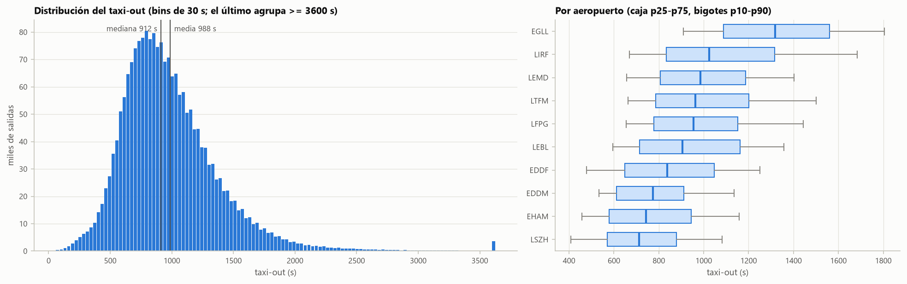
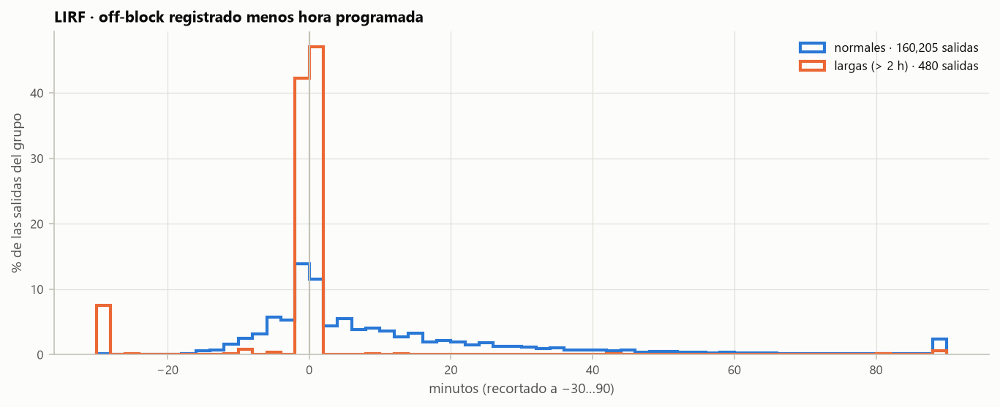
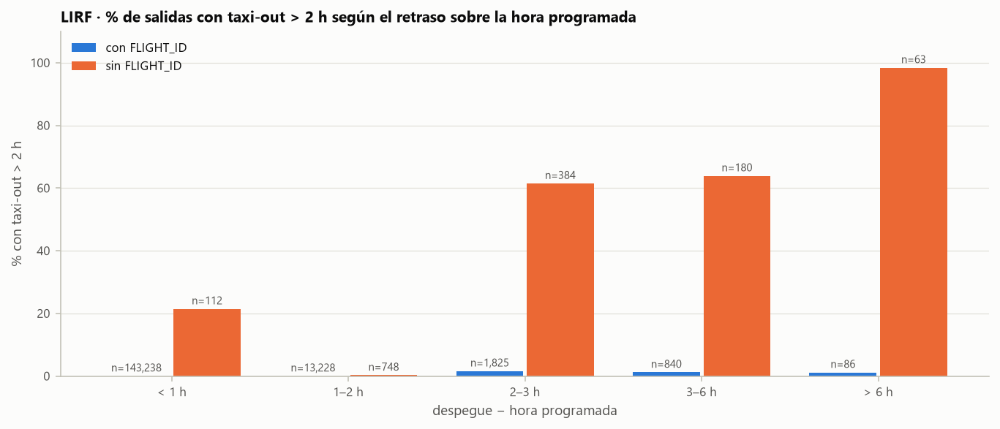
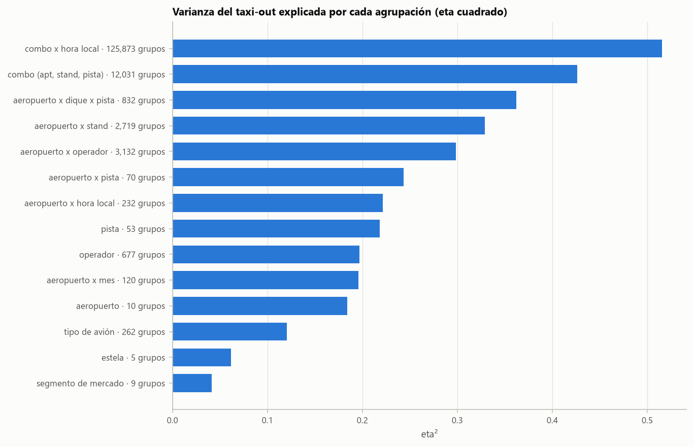
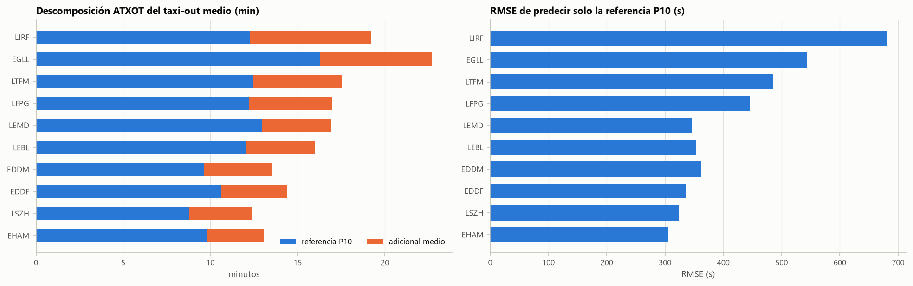
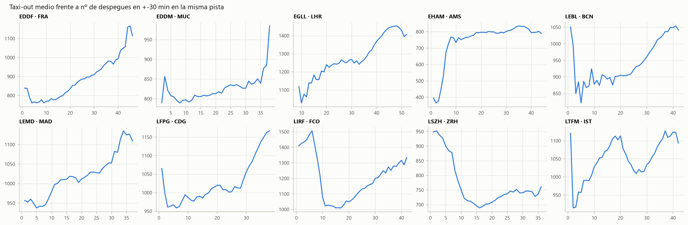
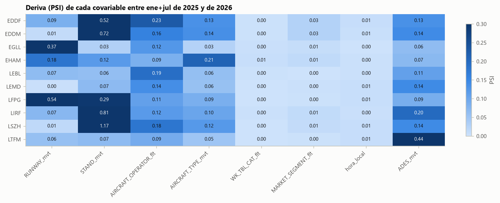
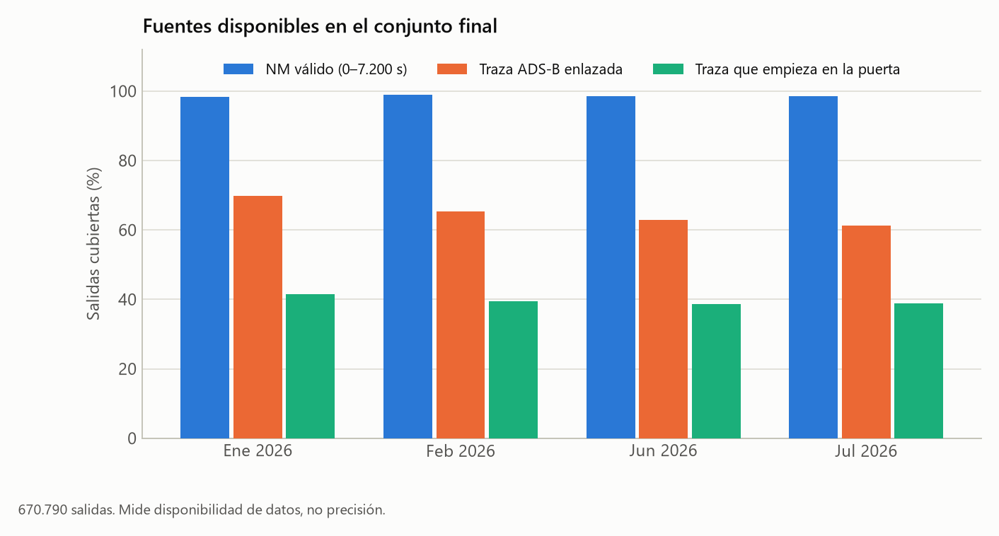

# Datos, análisis y evidencias

El EDA, la calidad de las fuentes, la preparación del conjunto final y dónde están las figuras y tablas. Las figuras antiguas explican decisiones que nos llevaron al modelo; indicamos su población y versión para que no se lean como evaluación de v30.

## 1. Qué hay en cada fuente

Los ficheros oficiales juntan dos sistemas: las columnas `_mvt` vienen del movimiento que registra el aeropuerto y las `_flt`, del plan de vuelo y el Network Manager. Si falta `FLIGHT_ID_mvt`, suele faltar todo el bloque NM.

| Campo | Significado | Uso |
|---|---|---|
| `MVT_ID_mvt` | Identificador del movimiento | Unir y ordenar las predicciones; no es predictor |
| `PHASE_mvt` | Salida o llegada | Separar las dos poblaciones |
| `TAXITIME_SEC_mvt` | Rodaje registrado, en segundos | Objetivo en las salidas de 2025; oculto en las de 2026 |
| `BLOCK_TIME_UTC_mvt` | Off-block en salidas, in-block en llegadas | Etiqueta en salidas de 2025; contexto en llegadas |
| `SCHED_TIME_UTC_mvt` | Hora programada | Señal de copia y de retraso |
| `AOBT_3_flt` | Off-block según NM | Referencia del residuo cuando es válido |
| `LOBT_flt`, `EOBT_1_flt`, `IOBT_flt` | Relojes del plan | Coherencia entre fuentes y proyección |
| Stand, pista, tipo, operador | Geometría y operación | Categóricas y cruces por aeropuerto |

Normalizamos desconocidos, timestamps y husos IANA, y calculamos la hora local por aeropuerto (Estambul no cambia de hora como Europa central). El off-block y el taxi-out ocultos de las salidas nunca entran en el modelo; las llegadas sí aportan contexto en los dos años.

## 2. La distribución y por qué importa la cola



En 2025 la media ronda los 988 s y la mediana los 912 s, con una cola derecha larga. Heathrow es lento pero regular; Roma, mucho más disperso.

| Aeropuerto | Taxi-out medio (s) | Lo que destaca |
|---|---:|---|
| LSZH | 743 | La media más baja |
| EHAM | 785 | Rodaje relativamente corto |
| EDDM | 812 | Invierno y stands nuevos |
| EDDF | 863 | Cobertura ADS-B en tierra variable |
| LEBL | 957 | Verano y copia del horario |
| LEMD | 1.015 | Diferencias por stand y operador |
| LFPG | 1.018 | Casos extremos y poca traza útil |
| LTFM | 1.052 | Invierno y poca cobertura ADS-B |
| LIRF | 1.151 | La mayor dispersión y off-blocks defectuosos |
| EGLL | 1.363 | Media alta pero regular |

Son medias de la población filtrada del EDA ([percentiles por aeropuerto](tablas/eda/03_percentiles_aeropuerto.csv)), no de las predicciones.

El primer análisis de extremos atribuía el 38,2 % del error cuadrático de la referencia a 208 vuelos, el 0,01 % de 2025 (un error de aquella referencia, no de v30). La [auditoría posterior](tablas/auditoria/segmentos_error.csv) confirmó que los errores de las fuentes y unas pocas duraciones enormes condicionaban v15.

Entrenamos el cuerpo solo con etiquetas entre 60 y 7.200 s para que aprenda el régimen habitual, pero las filas excluidas siguen en la evaluación y en el envío, y la cola y el respaldo tienen que predecirlas.

Hay 1.689 salidas no aptas (0,08 %): 584 de más de dos horas, 717 de entre 1 y 59 s y 388 de cero o negativas. En 430 de las 584 largas, el off-block coincide con la hora programada a ±30 s; las cortas no sabemos a qué se deben. Además, 22.470 salidas no tienen AOBT_3 (1,08 %) y son mucho más dispersas. Faltar NM y no ser apta son cosas distintas.

## 3. El problema clave: off-block igual a la hora programada



En las salidas de más de dos horas de Roma hay un pico de off-blocks pegados a la hora programada: un taxi-out enorme puede ser sobre todo retraso registrado desde un horario copiado, no un recorrido larguísimo.

Vimos tres problemas: copia del horario, posibles errores de fecha y desacuerdos entre sistemas. Ninguna bandera observable los detecta todos: un vuelo sin NM puede rodar con normalidad y uno con NM puede copiar el horario.



La relación entre retrasos de más de 2 h y falta de plan en Roma dio lugar a la regla especial. Al ver copias también entre las filas aptas pasamos, en V28/v30, a un clasificador de copia vuelo a vuelo; la regla sigue sirviendo para los extremos.

Los umbrales de 30 s (coincidencia), 60 s (suelo) y 2 h (entrenamiento) tienen funciones distintas y no son intercambiables.

## 4. Geometría: stand, pista y P10



Agrupar por aeropuerto explica alrededor del 18,4 % de la variabilidad, y por aeropuerto/stand/pista, el 42,6 %: hay que representar la geometría dentro de cada aeropuerto, aunque es una medida descriptiva hecha sobre la misma muestra.

La referencia, inspirada en ATXOT, es el P10 por combo con al menos diez vuelos iguales o por debajo de él (bastantes más de diez en total, salvo empates). Sin soporte suficiente bajamos a dique y pista, luego a pista y por último a aeropuerto.

| Nivel de respaldo | Salidas de 2026 cubiertas |
|---|---:|
| Aeropuerto–stand–pista | 90,10 % |
| Aeropuerto–dique–pista | 8,94 % |
| Aeropuerto–pista | 0,93 % |
| Aeropuerto | 0,03 % |

Fuente: [cobertura jerárquica](tablas/eda/06_cobertura_cadena_2026.csv), de aquel cálculo de referencia (no es la cobertura ADS-B ni el uso del P10 en v30).



La referencia media es de 712 s y el adicional medio de 276 s; usar solo el P10 da un RMSE de unos 432 s. La referencia explica el recorrido, no la espera. En v30 manda el NM válido y el P10 queda como respaldo y como variable.

Frente al ATXOT publicado (totales mensuales divididos por vuelos), los niveles medios de 2025 difieren menos de 0,85 min por aeropuerto, aunque LSZH, EDDM y LTFM tienen discrepancias estacionales, quizá por el deshielo o por filtros de población. Solo lo usamos de contraste: ni como etiqueta de 2026 ni como entrada de v30.

Más detalle: [varianza explicada](tablas/eda/04_varianza_explicada.csv), [poder de la referencia](tablas/eda/06_poder_referencia.csv), [comparación mensual](tablas/eda/12_contraste_atxot_2025.csv) y [descomposición comparada](tablas/eda/12_descomposicion_vs_publicada.csv).

## 5. Tráfico, horario y operación



Los recuentos por aeropuerto y pista aproximan la congestión, pero su relación con el rodaje cambia con el aeropuerto y la franja: de noche hay poco tráfico, pero aviones pesados, carga y menos pistas abiertas. No hay una corrección única por número de movimientos.

Agrupando por aeropuerto, día y hora aparece más estructura que solo por mes, y por eso usamos ventanas locales, geometría NM y excesos cercanos. El operador aporta poco una vez descontado el combo, aunque sus interacciones pueden servir.

El índice PSR (tráfico normalizado por capacidad) y el estudio PRU 2015 (otra referencia de baja congestión) están en el [documento de experimentos](02_Modelos_anteriores.md); ninguno entró en v30.

Más detalle: [perfil de madrugada](tablas/eda_final/f2_perfil_horario_descompuesto.csv), [resolución temporal](tablas/eda_final/f3_resolucion_temporal.csv), [congestión](tablas/eda/09_congestion_correlaciones.csv) y [aporte del operador](tablas/eda/07_aporte_sobre_combo.csv).

## 6. Fuentes externas

| Fuente | Qué usamos | Cómo |
|---|---|---|
| IEM / Iowa State | METAR de los diez aeropuertos, 2025 y 2026 | Descarga en `Data/metar/` y cruce temporal con los movimientos |
| adsb.lol vía ADSB.exposed | Trazas de 2025 y principios de 2026 | Licencia ODbL; extracción por fecha y recuadro |
| Archivo de adsb.lol en GitHub | Trazas de junio y julio de 2026 | Cuando ADSB.exposed ya no ofrece adsb.lol; por día |
| EUROCONTROL ATXOT | Totales mensuales de referencia y adicional | Solo contraste |
| Bibliografía y un repositorio público | Ideas sobre referencias, capacidad y fuentes | No son resultados nuestros |

Según nuestras notas, ADSB.exposed dejó de ofrecer adsb.lol en mayo de 2026; las pruebas con airplanes.live no llegaron a la receta. No hemos vuelto a revisar la disponibilidad ni los términos de estas fuentes.

En los METAR corregimos fenómenos compuestos, nubes y techo, y viento. En el pushback NM tomamos la última observación anterior que no sea demasiado antigua. Las banderas de helada o baja visibilidad describen el tiempo, no prueban deshielo ni procedimientos LVP. Volver a descargar los partes puede cambiar alguna variable.

Bibliografía consultada (no redistribuimos los PDF):

- EUROCONTROL PRU, *Additional taxi-out time performance indicator document*, edición 01.00, 16/03/2023. [Metodología del indicador](https://ansperformance.eu/methodology/additional-taxi-out-time/).
- Wu, Mao, Huang, Zeng, Ma y Jia, «Interpretable taxi-out time prediction of departure flights using stacking ensemble learning and SHAP analysis», *Scientific Reports* 16, 10066 (2026). [doi:10.1038/s41598-026-40898-5](https://doi.org/10.1038/s41598-026-40898-5).
- Lu, Li, Zhong, Zhong, Yu y Zhang, «DDA-SIM-ATT: A synergistic multi-module fusion model for high-precision prediction of departure flight taxi-out time», *Aerospace* 13, 314 (2026). [doi:10.3390/aerospace13040314](https://doi.org/10.3390/aerospace13040314).

Trabajan con otros periodos y aeropuertos; sus RMSE no son comparables con los del reto.

## 7. Deriva de 2025 a 2026



Cambian stands, pistas, operadores, mezcla de tráfico y meteorología. En EDDM hay stands nuevos que no aparecen en todo 2025, y ampliar el histórico de dos a doce meses no lo arregla; de ahí el respaldo jerárquico y las medidas de posición.

Sin el target de 2026 podemos revisar cobertura, nulos, identificadores y la distribución de las predicciones, pero un cambio en la media predicha no demuestra una mejora. Ajustarla a la media publicada para otra población puede empeorar, como pasó con el experimento PRU.

Más detalle: [deriva numérica](tablas/eda/12_deriva_covariables.csv) y [stands nuevos según la ventana](tablas/eda/12_stands_nuevos_ventana.csv).

## 8. Preparación del conjunto final

Con `PRC_PERIODO=final` se sustituyen las entradas de 2026 y todo se escribe aparte (`Data/interim_final/`, `Data/features_final/` y `Data/adsb/por_dia_final/`); las tablas base de 2025 se leen de las carpetas normales. `scripts/preparar_final.py` encadena base, fuente, ADS-B, stand y una comprobación final.

Los ficheros finales cubren enero, febrero, junio y julio: 670.790 salidas y 670.407 llegadas. En enero y julio los timestamps se mueven hasta unos ±12 s respecto al ranking inicial, lo que cambia NM, ventanas, relojes y enlaces, así que no reutilizamos las predicciones antiguas.



| Mes 2026 | Salidas | NM 0–7.200 s | METAR | Traza ADS-B | Desde puerta | Fuente off-block |
|---|---:|---:|---:|---:|---:|---:|
| Enero | 152.719 | 98,4 % | 100,0 % | 69,8 % | 41,5 % | 98,7 % |
| Febrero | 144.158 | 99,0 % | 100,0 % | 65,4 % | 39,5 % | 98,6 % |
| Junio | 181.791 | 98,6 % | 100,0 % | 62,8 % | 38,7 % | 98,6 % |
| Julio | 192.122 | 98,5 % | 100,0 % | 61,3 % | 38,9 % | 98,8 % |

Fuente: [tablas/modelo/cobertura_final.csv](tablas/modelo/cobertura_final.csv), copia de la que escribe `scripts/preparar_final.py comprobar`. METAR al 100 % no significa que todos sus campos estén completos.

Lo más llamativo es Frankfurt en febrero: alrededor del 34 % de los vuelos con traza, frente al 79 % de enero, porque a finales de enero se pierden puntos en superficie (no es un fallo de descarga). París y Estambul tienen poca traza útil y Roma pierde mucha en verano. Son huecos de información que no se arreglan con más árboles.

Recalculamos las variables de fuente de los dos años, porque `share_other` y `n_other` cuentan los vuelos nuevos, y las posiciones de los stands con 2025 y los cuatro meses. Las trazas de 2025 se reutilizan. La matriz sigue teniendo 177 columnas en el mismo orden.

La entrega final, hecha el 14/10/2026 con los modelos congelados de v30, está en el [modelo final](01_Modelo_final_v30.md#9-entrega-final).

## 9. Figuras y tablas

Solo guardamos lo que citan los documentos. La antigua `reports/` (215 ficheros: figuras de investigación, auditorías, inventarios, la bibliografía en PDF y un ZIP con la documentación original) está archivada en `Data/archivo/reports_20261014.zip`, fuera de git.

```text
Documentacion/
├── figuras/
│   ├── modelo/        figuras de v30 y de la entrega final (las genera scripts/figuras.py)
│   ├── eda/           distribución, geometría, tráfico y deriva (EDA histórico)
│   ├── no_aptas/      diagnóstico de etiquetas y off-block en Roma
│   └── peak_rate/     auxiliares de capacidad descartados
└── tablas/
    ├── modelo/        métricas, ablación, contrato de variables, error, importancia y entrega final
    ├── eda/           tablas numéricas del EDA
    ├── eda_final/     perfil horario y resolución temporal
    └── auditoria/     resumen de la auditoría de v15/v20
```

| Tabla | Para qué sirve | A tener en cuenta |
|---|---|---|
| [Métricas recientes](tablas/modelo/experimentos_disponibles.csv) | Comparar candidatas con sus JSON de origen | Solo con la misma partición, población y posproceso |
| [Ablación](tablas/modelo/ablacion.csv) | Diferencias por grupo, semilla y régimen | Con lr 0,06, no con el entrenamiento final |
| [Contrato v30](tablas/modelo/variables_v30.csv) | Nombre, orden, bloque e importancia de las 177 variables | Manda el modelo congelado |
| [Error histórico](tablas/modelo/error_aeropuerto.csv) | RMSE por aeropuerto, por mes y concentración del error | Receta v30 en la partición histórica, no el modelo enviado |
| [Entrega final](tablas/modelo/final_media_mes_aeropuerto.csv) | Medias, etapas del posproceso y comparación con v30 | Describe predicciones, no precisión |

[scripts/figuras.py](../scripts/figuras.py) trabaja en dos pasos: `tablas` calcula `tablas/modelo/` desde los datos locales (`Data/` y `Submissions/`) y `figuras` dibuja solo con esas tablas, así que basta el repositorio para rehacerlas (`python scripts/figuras.py figuras`, con Matplotlib). Las figuras del EDA son históricas; sus cifras están en `tablas/eda/` y `tablas/eda_final/`.
