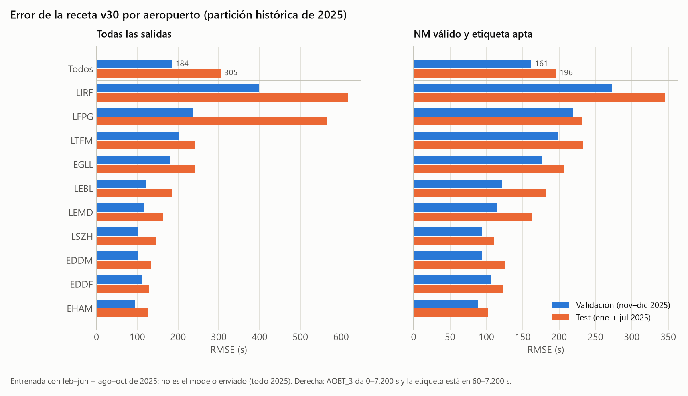

# PRC Data Challenge 2026 — departure taxi-out time

Solution of team **knowledgeable-alligator** for the [PRC Data Challenge 2026](https://ansperformance.eu/study/data-challenge/dc2026/) (EUROCONTROL Performance Review Commission and OpenSky Network). The task is to predict the **departure taxi-out time** (off-block to take-off, in seconds) of flights at ten European airports (EDDF, EDDM, EGLL, EHAM, LEBL, LEMD, LFPG, LIRF, LSZH, LTFM), scored by RMSE.

| Phase | Departures | Submission | Result |
|---|---:|---|---|
| Initial ranking (Jan + Jul 2026) | 344,841 | v30, uploaded as `knowledgeable-alligator_v29.parquet` | **RMSE 247.8635 s** |
| Final phase (Jan, Feb, Jun, Jul 2026) | 670,790 | v30 frozen models, `knowledgeable-alligator_final.parquet` (2026-10-14) | Accepted, 670,790 pairs; score not yet published |

The detailed documentation is **in Spanish** (see [Documentation](#documentation)); this README summarises it in English.


## Approach

**Reference.** The Network Manager taxi-out `take-off − AOBT_3` when it lies in 0–7,200 s; otherwise a hierarchical P10 of 2025 taxi-out times (stand/runway → pier/runway → runway → airport).

**Two CatBoost models on 177 features.** Part of the recorded off-block times are just the *scheduled* time copied into the airport system, so the label mixes physical taxiing with a recording artefact:

- a **copy classifier** estimates `p = P(|off-block − scheduled| ≤ 30 s)`;
- a **taxi regressor** learns `target − reference` on the departures that do not copy the schedule.

```text
taxi  = max(reference + regressor(x), 0)
sched = max(take-off − scheduled, 0)
body  = p · sched + (1 − p) · taxi
```

**Post-processing.** Calibration of the long-delay tail at Rome (LIRF), a four-source consensus for flights that every clock places beyond 2 h, a 60 s floor, and a projection onto `(take-off − LOBT) ± 3,606 s`.

**Features** (contract in [`variables_v30.csv`](Documentacion/tablas/modelo/variables_v30.csv)):

| Block | # | Content |
|---|---:|---|
| Base (inherited from earlier versions) | 137 | NM / schedule / EOBT / LOBT clocks and their disagreements, P10/P25 references, traffic and runway queues, congestion context, gate holding, METAR at take-off and push-back, clock resolution, airport/stand/runway/operator categories |
| Off-block source | 16 | Signals that the off-block is a copied schedule: NM matching history of the flight number, previous arrival at the same stand, copy rates of nearby arrivals, flight-number format, out-of-month target encodings |
| ADS-B (adsb.lol) | 20 | Link of each departure to its own trace (callsign and take-off time) and ground-segment measures: first seen, first movement, last still point, stops, path length, queue, coverage gaps |
| Gate / stand | 4 | Distance from the start of the trace to the estimated gate and stand positions, which tells an observed push-back from a trace that starts mid-taxi |

Open ADS-B traces were the decisive addition: removing them costs **+26.6 s** of validation RMSE and **+13.6 s** on the historical test.

## Results and limitations

On the 2025 historical split (train Feb–Jun + Aug–Oct, validation Nov–Dec, test Jan + Jul), the v30 recipe reaches **184.4 s** (validation) and **304.7 s** (test) RMSE over all departures, and **161.5 s / 195.6 s** where the NM reference is valid.

- **The RMSE is decided by a handful of flights.** In the historical test, a single departure carries 21.7 % of the squared error and the worst 1 % carries 75 %. Rome and Paris dominate the tail.
- **ADS-B coverage is uneven**: weak at Paris and Istanbul, a drop at Frankfurt in February 2026, and losses at Rome in summer.
- **Local validation is optimistic.** The inherited P10 references were fitted on all of 2025 and the splits were reused during research, so local scores contain some label information.
- **Known bug kept on purpose.** The v30 ADS-B extractor adds an offset where it should subtract it, in three time features. The fix is worth about −0.2 s locally, but v30 keeps the original sign so that its frozen models stay consistent with their inputs.
- **Retraining is not bit-reproducible.** CatBoost on GPU is not deterministic: retraining with the same seed gives predictions that differ from v30's by about 25 s RMS. Exact reproduction requires the frozen models.



## Repository layout

```text
├── Documentacion/      four documents (Spanish), figures/ and tables/ they cite
├── Notebooks/          00–07: full pipeline, period switch, submission
├── scripts/            downloads, features, matrix, training, figures, submission
│   └── experimentos/   model selection and ablation
├── prc/                shared package (prc/base: processing and the 137 base features)
├── configuracion/      feature recipe, flight-recovery table, frozen references (P10, categories, calibration)
├── Submissions/        per-version reports (informe.json) and submission records (registro_envio.json)
├── requirements.txt
└── LICENSE             GPLv3
```

`Data/` (about 13 GB locally), the models (`*.cbm`) and the prediction files are **not in the repository**. The sections below explain how to obtain them.

## Setup

```bash
pip install -r requirements.txt
```

- **Python:** tested with Python 3.11 and 3.14.
- **Hardware:** training needs an NVIDIA GPU (CatBoost `task_type="GPU"`). It took about 16 minutes on the original machine. Predicting with the frozen models runs on CPU.
- **Kernel:** the notebooks call the scripts with the same Python as their Jupyter kernel, so that kernel must have the requirements installed. Notebook 00 checks this before starting.

## Data

Nothing is redistributed: every source is downloaded by a script. Notebooks 01–03 run these downloads when their `DESCARGAR_*` switches are set to 1.

| Source | Content | How to obtain | Local size |
|---|---|---|---:|
| Challenge bucket (OpenSky S3, `prc-2026-datasets`) | `training_2025-*.parquet` (12 months), `ranking.parquet`, `submitting.parquet`, `final_ranking.parquet`, `final_submitting.parquet` | Team access keys in `credentials.json`, then `python scripts/descarga_reto.py` and `python scripts/descarga_reto.py final` | 400 MB |
| [Iowa Environmental Mesonet](https://mesonet.agron.iastate.edu/request/download.phtml) | METAR of the ten airports, 2025–2026 | `python scripts/descarga_metar.py 2025` and `... 2026` | 48 MB |
| [adsb.lol](https://adsb.lol) via the public ADSB.exposed ClickHouse | ADS-B points near the airports, 2025 and Jan–Feb 2026 | `python scripts/descarga_adsb_exposed.py 2025-01-01 2025-12-31 --hilos 3 --bloque 4` (same for 2026-01-01 → 2026-02-28) | |
| adsb.lol `globe_history_2026` archive on GitHub | ADS-B for Jun–Jul 2026 (no longer on ADSB.exposed after April 2026) | `python scripts/descarga_adsb_github.py 2026-06-01 2026-07-31 --procesos 6` (about 4 GB per day, streamed and filtered) | 6.1 GB of ADS-B in total |

`credentials.json` holds the challenge's MinIO keys and is ignored by git:

```json
{"accessKey": "<your access key>", "secretKey": "<your secret key>"}
```

Regenerating the data does not give byte-identical tables. A fresh METAR download changes up to 0.4 % of rows, the off-block source features vary by about 0.2 % of rows between runs, and a few aggregations break ties differently. Expect predictions very close to the submitted ones, not identical.

## Frozen models

The two v30 models are too large for git (the regressor is 398 MB). They belong in `Submissions/v30/` and are published as assets of the [`v30` release](../../releases/tag/v30):

| File | Model | Size | SHA-256 |
|---|---|---:|---|
| `clf.cbm` | Copy classifier, 3,300 trees | 15.2 MB | `e25bd08380d324e18172532d10c26ac1ec5b6cbeec24a84d7ff33eb88762523e` |
| `model.cbm` | Taxi regressor, 24,000 trees | 397.6 MB | `70df0e15c3b22e81933939f8a3fefd107db793c32d579301a16fe67ee7d461c5` |

Without them, notebook 06 with `REENTRENAR = 1` (or `scripts/entrenar.py` without `--modelos`) retrains an equivalent, non-identical model.

## Running

**Notebooks.** Open `Notebooks/00_v30_completo.ipynb` and set the options:

- `PERIODO`: `"ranking"` (January and July 2026) or `"final"` (the four final months).
- `REENTRENAR`: also retrain from scratch, besides predicting with the frozen models.
- `DESCARGAR_*` / `REHACER_*`: force downloads or recomputation; by default existing files are reused.

Then run it. It executes notebooks 01–06 in order and writes the predictions to `Submissions/<name>/`. Restart the kernel when switching periods.

**Command line** (Bash; in PowerShell set `$env:PRC_PERIODO = "final"` and escape the JSON quotes as `\"`):

```bash
# features of the final set (base, source, ADS-B, stand, consistency check)
PRC_PERIODO=final python scripts/preparar_final.py

# predict with the frozen v30 models
PRC_PERIODO=final python scripts/entrenar.py v30_final_modelos fuentes,adsb,adsb_stand 24000 1 3300 '{"learning_rate": 0.03}' --modelos=Submissions/v30

# retrain from scratch with the v30 recipe
PRC_PERIODO=final python scripts/entrenar.py v30_final fuentes,adsb,adsb_stand 24000 1 3300 '{"learning_rate": 0.03}'

# tables (needs local Data/ and Submissions/) and figures (only needs the tables in the repo)
python scripts/figuras.py tablas
python scripts/figuras.py figuras
```

**Submitting.** `Notebooks/07_envio.ipynb` validates a prediction file against the template and uploads it to the team bucket. It names the file `_v<N>.parquet` in the initial phase and `_final.parquet` in the final phase, and does nothing while `ENVIAR = 0`. It only works with the team's own credentials.

## Documentation

All four documents are in Spanish:

- [00_General.md](Documentacion/00_General.md): overview, project structure and how to run it.
- [01_Modelo_final_v30.md](Documentacion/01_Modelo_final_v30.md): the v30 recipe, its features, training, error analysis, variable importance, post-processing, ablation and the final submission.
- [02_Modelos_anteriores.md](Documentacion/02_Modelos_anteriores.md): how earlier versions evolved and the experiments that were discarded.
- [03_Datos_y_analisis.md](Documentacion/03_Datos_y_analisis.md): data fields, EDA, label quality, external sources, the bibliography, and the drift from 2025 to 2026.

## Licence

The code and documentation are released under the **GNU General Public License v3.0** (see [LICENSE](LICENSE)).

Data is not included, and each source keeps its own terms:

- **Challenge data:** PRC Data Challenge terms.
- **METAR:** Iowa Environmental Mesonet.
- **ADS-B:** adsb.lol data is licensed under the [ODbL](https://opendatacommons.org/licenses/odbl/). Derived ADS-B tables that you share must follow it.

`configuracion/` holds small reference tables computed from the 2025 challenge training data (P10 by stand/runway, category vocabularies, flight-level operator recovery). Inference needs them.

## Acknowledgements

Thanks to the EUROCONTROL Performance Review Unit and the OpenSky Network for organising the challenge and providing the data. Thanks to adsb.lol for the open ADS-B archive, and to the Iowa Environmental Mesonet for the METAR archive.
